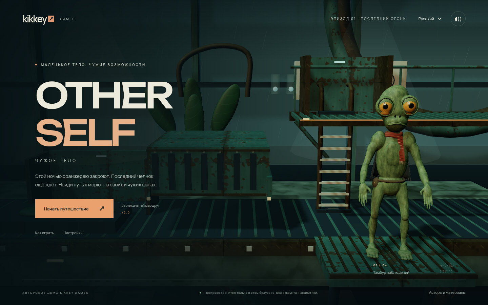
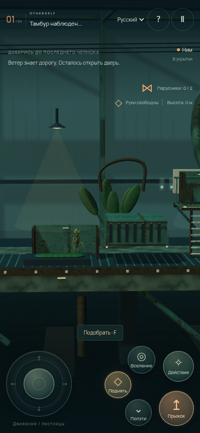

# OTHERSELF / ЧУЖОЕ ТЕЛО / גוף אחר

An original playable 2.5D stealth episode for **Kikkey Games**: four multilevel halls, two borrowable roles, two optional rescues, three endings. Version 2 adds physical jumping, manual crawling, ladders and throwable distractions; version 2.1 adds a virtual thumbstick and round action buttons. Built with Three.js, authored Blender geometry and procedural Web Audio.



## Run

Requires Node.js 22.12+ (validated with 24.22.1), npm and a browser supporting WebGL2.

```sh
npm ci
npm run dev
```

The development server listens on port 5173. All game models, fonts and audio generation are local; no CDN, account, API key or backend is required. Direct language selection: `?lang=ru`, `?lang=en`, `?lang=he`.

```sh
npm test                 # deterministic game rules, complete routes, dictionaries
npm run build           # distributable static site in dist/
npm run preview         # serve production build
npx playwright test     # browser acceptance; dev server must be running
```

Playwright configuration uses `/usr/bin/chromium` with software WebGL in this cloud environment. Adjust the executable path when testing on another computer. Do not interpret software rendering or a touch-sized viewport as a physical-phone performance result.

## Controls



On touchscreens, drag the virtual thumbstick on the left: left/right moves with speed proportional to the drag, while up/down climbs nearby ladders. Round buttons on the right handle actions. Multitouch lets you hold the stick with one finger and jump or interact with another; keyboard controls remain available.

- A/D or left/right arrows: movement (physical keyboard codes, unchanged in RTL).
- Space: jump; C or Control: toggle crawling. Standing up requires sufficient headroom.
- W/S or up/down arrows: climb a nearby ladder in either direction.
- F: pick up a nearby metal object, or throw the object in your hand in the direction you face. Its impact attracts nearby guards.
- E: contextual action; Q: possess / return.
- Escape: pause/resume. Help, journal, settings, retry and exit are accessible through the interface.

Face a worker within six metres; the double amber collar marks your target. Stay connected for 0.6 seconds. Leave Nim in a protected recess: his body remains vulnerable. A keeper can use hand readers; a technician operates gear consoles. Their elevated posts require real routes through the station: climb, use low service passages, cross broken platforms and distract patrols with thrown objects. Only Nim crosses hall boundaries. Rescue the two sail creatures if you wish; the final bell on the upper shuttle deck ends the episode. Backtracking remains possible before ringing it.

Local save includes room, active body, vertical movement and ladder state, held items and projectiles, worker investigations, machinery progress, gates, rescues and safe checkpoint. Version 1 saves migrate to a safe entrance in the redesigned room while retaining completed gates and rescues. Settings persist separately. Corrupt saves fall back safely. No cloud synchronization or analytics.

## Structure and embedding

`src/engine.js` is deterministic world logic, independent of the renderer and browser. `src/scene.js` renders true 3D geometry, `src/audio.js` owns Web Audio, `src/i18n.js` contains complete dictionaries. `src/joystick.js` handles analog thumbstick input and pointer capture. `src/main.js` exposes `mount(container)`, returning `start`, `pause`, `resume`, `destroy`, `getState`, `getMode`; the standalone bootstrap mounts the local page. Destroy releases listeners, animation frame, audio and GPU resources. CSS is scoped under `.otherself` except the minimal standalone page defaults.

Editable Blender files and generators live in `art/`; optimized GLBs and local PBR textures live in `public/assets/`. See [asset provenance](docs/ASSETS.md), [design](docs/DESIGN.md), [vertical level routes](docs/LEVEL_DESIGN.md), [localization/audio notes](docs/LOCALIZATION_AUDIO.md), and [validation/limitations](docs/QA.md).

## Validation boundaries

First-play duration has not been measured with first-time human players; the older flat-route timing does not describe version 2. Nim uses a weighted skeleton and baked normal/albedo maps, with a lower-detail mobile mesh. The eight-second finale includes boarding, rescued creatures and departure, and can be paused or skipped. Physical-phone performance and native-speaker Hebrew review remain external validation tasks; see exact version-specific test evidence in docs/QA.md.

Possible next episode: a wind-harvesting pier with the same two roles and rescued gliders as environmental storytellers. It is outside this build's scope.

**[Play OTHERSELF](https://oleg2v.github.io/GAMES-OTHERSELF/)** on GitHub Pages. The deployment and verification status are described in [deployment instructions](docs/DEPLOYMENT.md). No existing Kikkey site routes, DNS, analytics or outbound messages are changed. Post-game contact buttons only open the existing Kikkey email/WhatsApp destinations.
